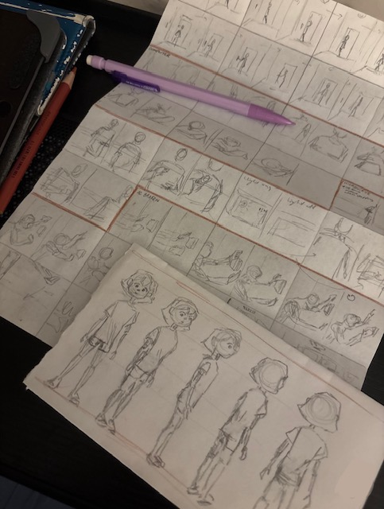

# Fall 2026 Senior Interdisciplinary PBL | CCHS & G+STEAM Magnet Center

## Introduction

As both the demand and cost of energy continues to rise, more and more people are negatively impacted by this energy crisis. As a result, government leaders should take the initiative towards determining <em>who</em> is most heavily affected and <em>what</em> specific actions should be taken. These societal issues beg the question: **Should access to clean and affordable energy be considered a natural right? Is access to clean, affordable energy necessary for achieving equality in a developed society?**

## AP U.S. Government and Politics Policy Investigation

When investigating potential policy solutions, aspects such as political science, constitutional principles, political ideology, current events, and evidence must be taken into account.  

- **Federalism** - Our United States government currently operates on a system of federalism, in which the power is divided between the state and federal government. 
- **Interdisciplinary Connections** – Reading <em>Into the Wild</em> brings audiences on Chris McCandless' journey of self-discovery in which he absolutely rejects technology and energy. This brings attention to the cruel reality of nature's harsh and unforgiving spirit and provides the reasoning and context as to why clean, affordable energy is a necessity in today's world.  Within math, different graphs, tables, and other forms of data can be analyzed to observe the energy, social, and financial divide between those who with/without energy, predictions for energy use, and predictions for energy consumption. These numbers are important for determining who needs energy, how to distribute it, and its overall impact on society. 
- **Political Ideology and Energy Policy** – While two people may agree that energy is important, they may disagree on how the government should approach and implement solutions. For example, one person may want the government to prioritize the maintenance of costs for regular households while another person may aim to prioritize limiting the effect of energy monopolies. Along with this, people may disagree on how much of a role the government should play within this aspect, and more specifically, the specific government that should have the most control (state vs. federal), and to what extent.
- **Our Position** - Energy should be treated as a basic public necessity, but not necessarily as a natural or constitutional right. Natural rights are protections from government overreach, not guarantees to material goods. However, because power is vital for survival, the state must regulate and subsidize it as a public necessity to ensure baseline societal equality.
- **POLICY PROPOSAL** - Our proposed policy (California Solar Energy Affordability Policy) utilizes large plots of safe, unused land for solar panel installments and is aimed to support low-income households with additional clean energy. One specific location could be available land in the Mojave Desert, in which acres of solar panels can be installed. These solar panels will generate clean energy that will be used to support those most affected by energy burden such as low-income households and high-energy burden households. Mathematical models can be used to analyze the data and statistics necessary to determine the efficiency of said policy such as how much energy is produced, how much energy is consumed, and how much the energy costs. Specifically, limits can model the long term growth of energy production while derivatives can model the changing energy cost.

#### AP U.S. Government Interdisciplinary Aspect
>  - <em>(includes relevant data, current events, ideological analysis, AP Government connections, policy review)</em>
 **Policy Brief:** https://docs.google.com/document/d/1kf7ahCMfd5w96LbcOCmZLIp_2MNK8mcp06AgVLIrXPE/edit?usp=sharing

## ERWC <em>Into the Wild</em> Poster

## PSA Video

While energy helps contribute to multiple aspects of daily life, providing a cooling/warming system is a prominent aspect. The goal for this video was to evoke emotion within audiences by revealing the difference in scenarios between someone with and without energy during a heat wave. In this video, two side-by-side comparisons are given, with slight differences between an air conditioning system that works vs a system that doesn't turn on. 
  By bringing attention to a specific energy-related event and its impact on one aspect of daily life, this PSA video brings awareness to the importance of energy and why it should be a necessity for all households. 

## UML Diagram

Put and image of your UML Diagram here. Upload the image of your UML Diagram to your repository, then use the Markdown syntax to insert your image here.

## Description

> Write a description of your project here. Include what your store you made, and why you chose this topic. In your description, include as many vocab words from our class to explain how you represented the item/service from your store. If you have user input, explain how the user will interact with your store such as which questions are prompted to the user, what response is your program expecting, and how that is use to output information for your store in the console
